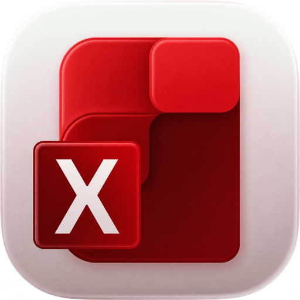

  

# Excel AW

**Excel AW** é um sistema de planilhas para uso interno na Alimentos Wilson. Caio Rodrigues criou a edição para facilitar tarefas do dia a dia da empresa, como a conferência de mercadorias recebidas. O projeto tem como base o [GridCraft](https://github.com/storytold/gridcraft).

O aplicativo abre e salva planilhas `.xlsx` e oferece fórmulas em português, como `SOMA` e `SE`. O idioma das fórmulas pode ser escolhido separadamente do idioma da interface. O modelo **Conferência de recebimento**, no menu **Arquivo → Novo**, ajuda a registrar notas fiscais, lotes e quantidades. A planilha calcula a diferença entre o pedido e o recebimento e sinaliza os itens que precisam de conferência.

## Por que Rust?

O aplicativo, o motor de cálculo e a leitura dos arquivos são escritos em **Rust**. Uma planilha precisa recalcular células rapidamente e lidar com documentos de estruturas variadas. Rust permite controlar o custo dessas operações e faz o compilador verificar o uso da memória em código seguro. A divisão entre cálculo, arquivos e interface também facilita testar cada parte do sistema.

## Licença

**Icarus 4.5** é o nome exibido no Excel AW. Os termos e créditos do projeto estão em [NOTICE](NOTICE), [LICENSE-MIT](LICENSE-MIT) e [LICENSE-APACHE](LICENSE-APACHE).
